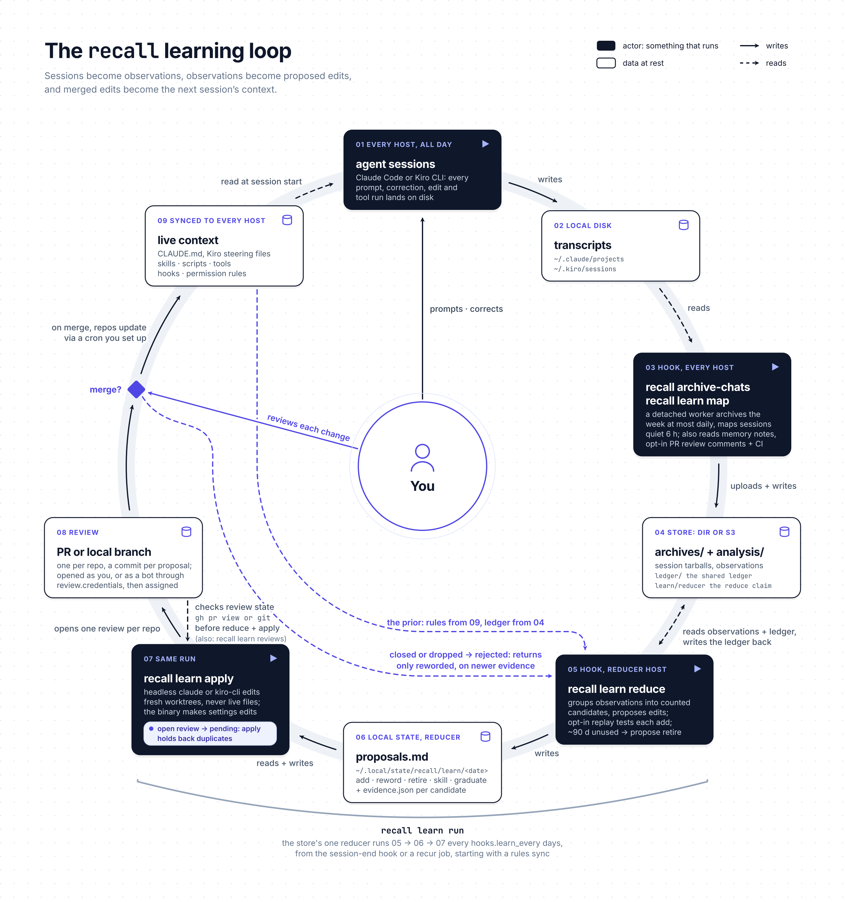

# recall

*Turn your coding agent's session history into memory: rules, skills, and tools you review.*

Every time you interact with an LLM, you spend time and attention steering it toward your goal.
You remember your past sessions, but each new session starts with no memory of your corrections or the model's own failures.
So you end up writing long prompts full of safeguards, hoping to get what you want on the first try.
Some of those safeguards move into rule files loaded into every session, such as `~/.claude/CLAUDE.md` or `~/AGENTS.md`. That helps, but every line costs context in every session, and someone has to keep the file pruned.

`recall` learns from your agent sessions and turns those lessons into rules, skills, and tools.

It works by reading your session transcripts with a small model to find repeated instructions, workflows, skills, and failures across sessions and even across harnesses.
Once a pattern shows up often enough, recall proposes candidate rules, skills, and tools to you in a GitHub pull request or an on-disk git branch.
`recall` never edits a live file, every change waits for your review.

<picture>
  <source media="(prefers-color-scheme: dark)" srcset="docs/img/recall-loop-dark@2x.png">
  
</picture>

## Tenets

- **Corrections should stick.** A correction can be a one-off, so recall waits until it comes up again.
  Once it has, you shouldn't have to make it a third time.
- **Rules are earned.** A rule or skill stays only while your sessions keep showing it's needed.
  Every line costs context in every session, so one that stops earning its place goes.
- **You own your context.** You decide how much it changes on its own.
- **Rules graduate to code.** If a script can check or enforce a rule, it should, and the prose rule retires.
  A rule the agent can't break beats one it has to remember.
- **Native memory is an input, not a competitor.** Your harness's own memory notes are evidence recall reads, lints, and promotes from.
  What recurs there earns a place in a reviewed context file that travels to every machine.
- **Memory, and nothing else.** recall captures sessions, archives them, and learns from them.
  A feature that isn't about what your agent should remember belongs elsewhere.

## How it works

recall runs in four steps:

- **Archive:** save each week's session transcripts to the store, one compressed tarball per harness, machine, and week.
- **Map:** a model reads each new or changed session once and records observations: your corrections, context you repeated, tool failures, skills it should have used, and rules it followed or broke.
- **Reduce:** group alike observations across sessions and hosts into counted candidates. 
  From those, propose new or reworded rules, skill changes, retiring rules no session has needed lately, and scripts for rules that code can enforce.
- **Propose:** stage each proposal as its own commit in a git worktree, never a live file, and send each changed repo to you for review as a pull request or a local branch.

The model calls go through your harness's own command-line tool, so they use the login and billing you already have.

Read more: the [learning loop design](docs/learning.md), and [`config.example.toml`](config.example.toml) for every key.

## Requirements

Archiving needs only the `recall` binary.
The rest depends on what you turn on.

- `git` for learning. Proposals are staged on a git branch, so every context file has to sit in a git checkout.
- `claude` or `kiro-cli` for learning. Model calls go through your harness's own CLI.
- `gh` for review by pull request (`learn.review = "pr"`) and the `github` evidence source.
- `cron` or `launchd` for schedules installed by `recall recur`.
- AWS credentials for an S3 store. recall talks to S3 itself, so the AWS CLI is optional.
- Go to build from source.

## Install

With Homebrew, on macOS or Linux; the tap is this repo:

```sh
brew tap micahhausler/recall https://github.com/micahhausler/recall
brew install --cask recall
```

With Go:

```sh
go install github.com/micahhausler/recall/cmd/recall@latest
```

Or download a release archive for macOS or Linux on amd64 or arm64 from the releases page; `checksums.txt` beside them has each archive's SHA-256.

To use the skills, install the repo as a Claude Code plugin:

```sh
claude plugin marketplace add micahhausler/recall
claude plugin install recall@recall
```

The skills run in Claude Code (not the Claude desktop app) and drive the `recall` binary, which reads transcripts from every enabled harness.
`recall init` is the short path for a new machine; the `recall-setup` skill walks you through every choice, including an S3 store and scheduled jobs.
The plugin also installs the session-end hook, which does nothing until `[hooks]` in your config turns a step on.

To use the skills in Kiro CLI, install a checkout of the repo as a Kiro power:

```sh
git clone https://github.com/micahhausler/recall ~/src/recall
kiro-cli powers install ~/src/recall
```

Kiro has no session-end hook, so with Claude Code off (`recall config set harness.claude.enabled false`) `recall init` declares recur jobs for the loop instead, and `recall recur sync` installs them.

## Supported harnesses

recall supports Claude Code and Kiro CLI.

| Harness | Transcripts | Context files | Runner |
| --- | --- | --- | --- |
| `claude` (on by default) | `~/.claude/projects` | `~/.claude/CLAUDE.md` and its `@` imports | `claude -p` |
| `kiro` | `~/.kiro/sessions`, both the v2 and v3 engine layouts | `~/.kiro/steering/**/*.md`, including `AGENTS.md`, and the Markdown files they link | `kiro-cli chat --no-interactive` |

Claude Code isn't required.
With `harness.claude` off, the loop's defaults follow Kiro: `learn.runner` is `kiro`, and the rule ledger and graduated skills live under `~/.kiro`.
The kiro runner maps and reduces but never applies: Kiro trusts a tool on any path, so it can't keep edits inside the apply worktrees, and `recall learn run` leaves its proposals in `proposals.md` for you.

## Skills drive the binary from inside a session

- [`recall-setup`](skills/recall-setup/SKILL.md): Walk through first-time setup, with every choice `recall init` makes for you.
- [`keep`](skills/keep/SKILL.md): Propose up to three lessons at the end of a session and apply the ones you approve.
- [`archive-chats`](skills/archive-chats/SKILL.md): Set up, check, or run the weekly archive, including an S3 bucket.
- [`recur`](skills/recur/SKILL.md): Declare, change, sync, or debug recurring jobs.
- [`report-issue`](skills/report-issue/SKILL.md): Draft a GitHub issue on this repo and file it only after you approve the text.

### Extend

Add your own steps to a recall skill or the reduce and apply prompts without forking them.
List files under `[extensions]`, keyed by skill name (`keep`, `recur`, `archive-chats`, `report-issue`), `learn-reduce`, or `learn-apply`:

```toml
[extensions]
keep = ["~/.config/recall/keep.md"]
```

Each skill ends with an "Owner additions" section that loads `recall extension <name>` when the skill starts, and the reduce and apply steps append `learn-reduce` and `learn-apply` to their input as owner instructions.
The files are instructions with the skill's permissions, so keep them in your own dotfiles.
For tools of your own, keep a separate private repo or plugin and point these files at it.

## Configure

Config is TOML, layered: `~/.config/recall/config.toml`, then every `~/.config/recall/config.d/*.toml` in lexical order.
A later file wins key by key; `enabled = false` in a later file turns off a job or harness an earlier one declared.
`$RECALL_CONFIG` overrides the base path.

Every key is documented in [`config.example.toml`](config.example.toml).

```sh
recall config show                 # the merged result, with the file and line each value came from
recall config get store.kind       # one value
recall config set store.kind s3    # writes only to config.d/90-set.local.toml, never to a file you edited
```

An S3 store needs AWS credentials and permissions on the bucket.
[`docs/store.md`](docs/store.md) lists the IAM actions each role needs and has an example policy.

## Inspirations

- [Lamis Mukta, Learning while you sleep: Beyond memory to dreaming](https://www.youtube.com/watch?v=tTcxVv8HHNw): dream over full archived sessions out of band, tool calls included, and propose memory changes with the evidence sessions attached.
- [Kieran Klaassen, compound engineering](https://creatoreconomy.so/p/how-to-make-claude-code-better-every-time-kieran-klaassen): write the lesson down at the end of each cycle so the context files compound.
- [Mitchell Hashimoto, My AI Adoption Journey](https://mitchellh.com/writing/my-ai-adoption-journey): every rule traces to an observed bad agent behavior, so rules are earned by evidence.
- [Teresa Torres on How I AI](https://www.chatprd.ai/how-i-ai/teresa-torres-claude-code-obsdian-task-management): ask at session end what should be documented, the manual form of the learning loop.
- [Boris Cherny, how he uses Claude Code](https://x.com/bcherny/status/2007179832300581177): a CLAUDE.md that is updated from review rather than written once.
- [Shrivu Shankar, How I Use Every Claude Code Feature](https://blog.sshh.io/i/177742847/custom-subagents): CLAUDE.md as guardrails plus pointers, which is why stale paths in context files are worth linting.
- [Garry Tan, gbrain](https://github.com/garrytan/gbrain): thin harness, fat skills, and graduating deterministic rules into scripts.

## License

recall is licensed under the [Apache License 2.0](https://github.com/micahhausler/recall/blob/main/LICENSE).
